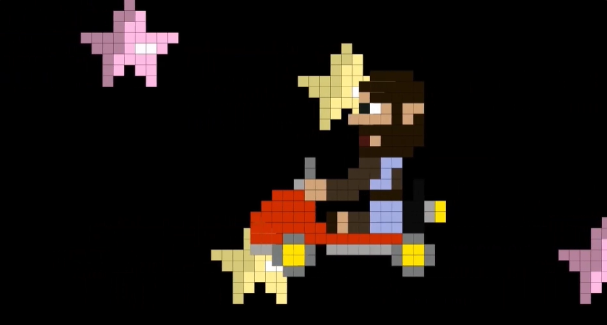

# Python-Manim-Project-for-a-STEM-camp-application
A Python project on VS code, utilizing the Manim library for mathematical objects and coding complex equations. This video is an amalgamation of Science, Philosophy and Art, coded using Python. Please note that the sound effects were edited in individually.
click the image to watch the video:

  

